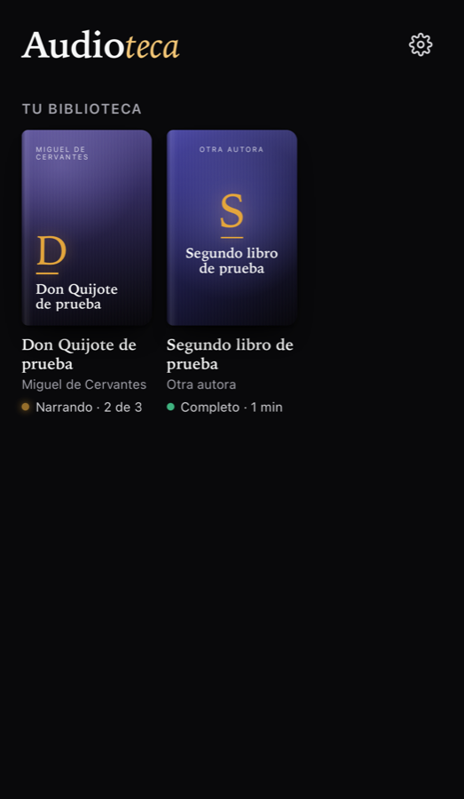
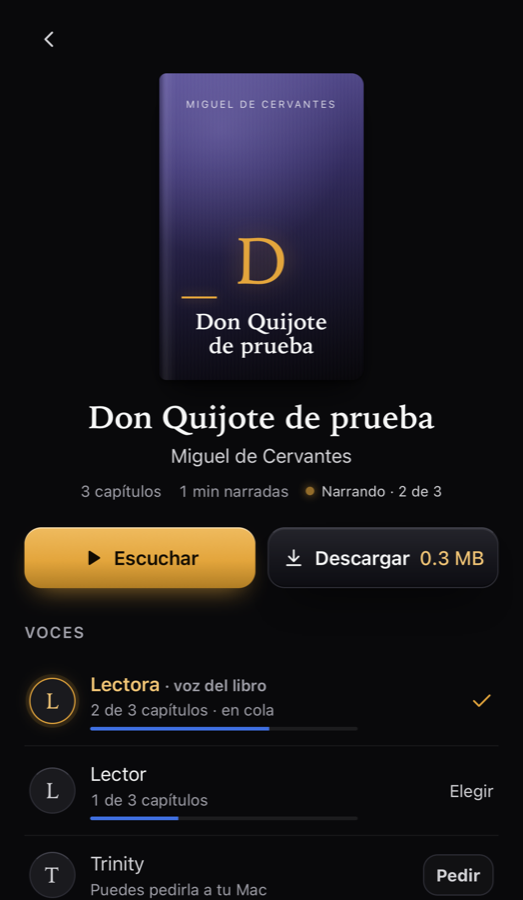
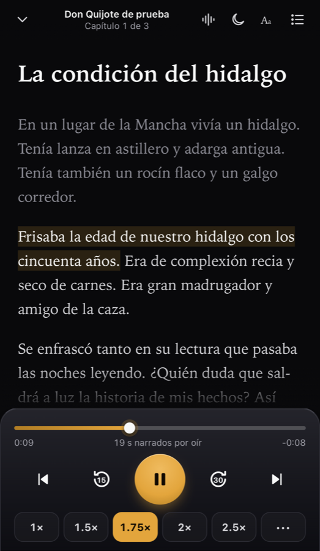
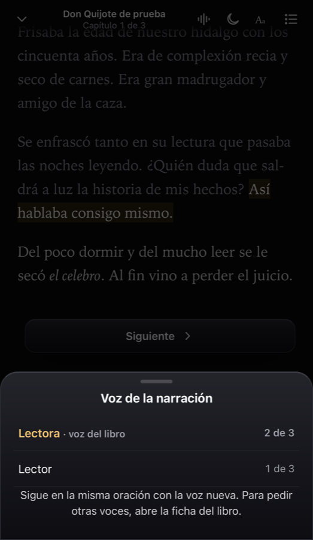

# Audioteca

Convierte **tus** libros (PDF o EPUB) en audiolibros en español con inteligencia artificial que corre **en tu
Mac**, sin pagar APIs ni subir nada a la nube, y escúchalos desde el iPhone con el texto resaltado mientras suena.

<p align="center">
  
  
  
  
</p>

```
 PDF / EPUB ──► extraer ──► (traducir EN→ES) ──► narrar ──► app en el iPhone
               texto limpio   Gemma 4 12B local    Qwen3-TTS local   escuchar · leer · descargar
```

| Pieza | Qué hace | Corre con |
|---|---|---|
| **Extractor** | PDF, EPUB, TXT o Markdown → capítulos limpios: quita cabeceras, números de página, índice, copyright y notas; rehace párrafos; entiende EPUB que usan `<div>` en vez de `<p>` | `pdftotext`, Python |
| **Traductor** | Inglés → español latino, párrafo por párrafo con contexto, glosario obligatorio y control de calidad automático (detecta inglés sin traducir, omisiones, bucles, cifras perdidas) | Gemma 4 12B en MLX (GPU del Mac) |
| **Narrador** | Texto → mp3 por capítulo con los tiempos de cada oración. Voz de macOS (instantánea), voz genérica de Qwen, o **tu propia voz clonada** con 15 s de grabación | `say` o Qwen3-TTS 0.6B en MLX |
| **App (PWA)** | Biblioteca, reproductor con pantalla bloqueada, velocidad 0.75×–3×, temporizador, texto resaltado sincronizado, cambio de voz sin perder la oración, progreso guardado, descargas offline | Node 20+, sin dependencias |

> [!IMPORTANT]
> **Aviso de uso.** Usa la Audioteca solo con libros que **posees legalmente** y para tu **uso personal**. No
> compartas, publiques ni vendas los audios o traducciones que generes: los derechos del libro siguen siendo de
> sus autores y editoriales. Clona solo **tu** voz o la de alguien que te dio permiso explícito. Cada modelo de
> IA (Qwen3-TTS, Gemma) tiene su propia licencia: revísala en su página de Hugging Face.

## Requisitos

- Mac con **Apple Silicon** (M1 o más nuevo) y macOS 14 o más nuevo.
  En un Mac con Intel funciona el modo `--sin-ia` (extraer + voz de macOS), sin traductor ni voces de Qwen.
- **16 GB de memoria** recomendados (el traductor de 12B usa ~8 GB). Con 8 GB: voz de Qwen sí; para traducir usa
  `AUDIOTECA_MOTOR_TRADUCCION=tgemma-4b`.
- **~12 GB libres** para los modelos (voz ~1 GB, traductor ~7.5 GB), que se descargan una sola vez.
- [Homebrew](https://brew.sh). El instalador pone lo demás: Node, ffmpeg, poppler y uv.
- Un iPhone (o cualquier teléfono) en la **misma red Wi-Fi** que el Mac.

## Instalación (un comando)

```bash
git clone https://github.com/<tu-usuario>/audioteca.git && cd audioteca && ./setup.sh
```

`setup.sh` instala las herramientas que falten, crea el entorno de Python con MLX, copia `.env.example` a `.env`
y crea la voz genérica de Qwen (descarga ~1 GB). Se puede volver a correr sin miedo. Opciones:
`--sin-ia` (solo voz de macOS), `--sin-modelos` (no descargar nada aún), `--dev` (para correr las pruebas).

Prueba que todo funciona con un fragmento del Quijote (dominio público):

```bash
./audioteca demo      # lo agrega a tu biblioteca y lo narra con la voz de macOS (segundos)
./audioteca servir    # abre la app; imprime la URL para el iPhone
```

## Uso: de PDF a tus oídos

### 1. Libro en español → texto

```bash
./audioteca libro ~/Libros/mi-libro.epub --slug mi-libro --ver        # revisa qué capítulos detecta
./audioteca libro ~/Libros/mi-libro.epub --slug mi-libro --titulo "Mi libro" --autor "Autora"
```

El `slug` es el nombre de la carpeta (minúsculas, números y guiones). El libro queda en `biblioteca/mi-libro/`
con estado `texto-listo`. Tu archivo original nunca se modifica.

Si un PDF no trae índice y los capítulos salen mal, dile las páginas: crea `capitulos.json` con
`[["Capítulo 1", 9, 24], ["Capítulo 2", 25, 40]]` (páginas del PDF, inclusivas) y usa `--capitulos capitulos.json`.

### 2. Libro en inglés → traducir

```bash
./audioteca traducir ~/Books/book.pdf --slug mi-libro --solo-extraer   # revisa capítulos (no usa el modelo)
./audioteca traducir ~/Books/book.pdf --slug mi-libro --titulo "Título en español" --autor "Autor" \
    --glosario mi-glosario.md
```

- **Glosario** (opcional, recomendado para libros con conceptos propios): cada término se traduce siempre igual y
  la primera vez aparece con su original, p. ej. «mentalidad de crecimiento (*growth mindset*)». Formato en
  [docs/FORMATO.md](docs/FORMATO.md#glosario-glosariomd).
- **Control de calidad**: al final deja `biblioteca/mi-libro/calidad-traduccion.md`. Si algo grave falla, el
  libro queda en `revision-traduccion` y no se narra hasta que lo revises y lo apruebes con `--forzar-listo`.
  Con `--revisar-antes` siempre espera tu aprobación.
- **Reanudable**: si apagas el Mac a medias, vuelve a correr lo mismo y sigue donde iba.
- Velocidad orientativa: ~250-300 palabras por minuto en un Mac con chip Max (un libro de 60 000 palabras, unas
  4 horas). Corre con prioridad baja; puedes seguir usando el Mac.

### 3. Narrar

```bash
./audioteca narrar                              # narra todo lo pendiente y termina
./audioteca narrar --libro mi-libro             # solo ese libro, en su voz
./audioteca narrar --libro mi-libro --voz mi-voz-clon
./audioteca estado                              # qué hay, en qué voz y cuánto falta
```

Si se interrumpe, al volver a correrlo reanuda en la oración donde se quedó. Velocidad orientativa: la voz de
macOS narra ~6× más rápido que tiempo real; Qwen, entre 1× y 2× (un libro de 8 horas tarda 4-8 horas: déjalo
de noche).

### 4. Escuchar en el iPhone

```bash
./audioteca servir
#   http://localhost:3410/
#   http://192.168.1.23:3410/     ← esta en el iPhone
```

En el iPhone, abre esa URL en **Safari** → botón Compartir → **«Agregar a inicio»**. Se abre a pantalla completa,
sigue sonando con la pantalla bloqueada y recuerda dónde te quedaste en cada libro.

- **Contraseña**: por defecto la app está abierta a quien esté en tu Wi-Fi. Para pedir contraseña, pon
  `AUDIOTECA_CONTRASENA=algo-largo` en `.env` y reinicia `./audioteca servir`.
- **Que arranque sola**: `./audioteca servicio instalar` deja la app y el narrador (en modo vigilante: narra
  cada libro nuevo que agregues) corriendo al iniciar sesión. `./audioteca servicio quitar` lo deshace.

### Escuchar sin red (descargas offline)

Por `http://<ip>:3410` puedes escuchar en streaming en casa. Para **descargar** libros al teléfono (gimnasio,
avión, coche) Safari exige HTTPS. Dos formas:

1. **Tailscale** (gratis, también te deja escuchar fuera de casa): instala Tailscale en el Mac y el iPhone y en el
   Mac corre `tailscale serve --bg 3410`. Entra desde el iPhone a `https://<nombre-de-tu-mac>.<tu-tailnet>.ts.net/`.
   Pon `AUDIOTECA_HOST=127.0.0.1` y `AUDIOTECA_COOKIE_SEGURA=1` en `.env`.
2. **Certificado propio** con [mkcert](https://github.com/FiloSottile/mkcert):
   `brew install mkcert && mkcert -install && mkcert -cert-file .data/cert.pem -key-file .data/key.pem 192.168.1.23`,
   pon `AUDIOTECA_TLS_CERT=.data/cert.pem` y `AUDIOTECA_TLS_KEY=.data/key.pem` en `.env`, e instala en el iPhone
   la autoridad de mkcert (`mkcert -CAROOT` → envía `rootCA.pem` al iPhone, instálalo y actívalo en
   Ajustes → General → Información → Ajustes de confianza de certificados).

## Voces

```bash
./audioteca voz listar
./audioteca voz probar qwen-clon "Había una vez un faro al final del puerto."
```

| Voz | Calidad | Velocidad | Cómo se obtiene |
|---|---|---|---|
| `macos` | robótica pero clara | muy rápida | viene con el Mac (Paulina, Mónica…; elige con `AUDIOTECA_VOZ_MACOS`) |
| `qwen-clon` | natural | 1-2× tiempo real | `./audioteca voz base` (lo hace `setup.sh`) |
| `tu-voz-clon` | natural, con tu timbre | 1-2× tiempo real | `./audioteca voz clonar` (abajo) |

La voz de los libros nuevos se elige con `AUDIOTECA_VOZ` en `.env`. Cada libro puede tener varias narraciones y
desde la app puedes **pedir otra voz** para un libro: el narrador hace primero el capítulo 1 como muestra.

`qwen-clon` es la voz genérica del propio modelo: Qwen3-TTS sin referencia inventa un hablante distinto en cada
frase, así que `voz base` genera una muestra con semilla fija y la usa como referencia para todo el libro. ¿No te
gusta? `./audioteca voz base --semilla 7` (u otro número) crea otra.

### Clonar tu propia voz

1. Graba **10 a 20 segundos** hablando con naturalidad, en un lugar callado, sin música (Notas de voz del
   iPhone o QuickTime en el Mac sirven). Lee algo con pausas y alguna pregunta; habla como quieres que narre.
2. Escribe **exactamente** lo que dijiste, palabra por palabra.
3. Clónala:

   ```bash
   ./audioteca voz clonar mi-voz ~/Desktop/grabacion.m4a "Hola, soy yo. Esta es la voz con la que quiero escuchar mis libros. ¿Se oye bien?"
   ./audioteca voz probar mi-voz-clon
   ./audioteca narrar --libro mi-libro --voz mi-voz-clon
   ```

Quedan `voces/mi-voz.wav` y `voces/mi-voz.txt` (nunca se suben a git). Si la transcripción no coincide con el
audio, el clon sale raro: corrige el `.txt` y vuelve a narrar.

## Configuración (`.env`)

| Variable | Defecto | Para qué |
|---|---|---|
| `AUDIOTECA_LIBROS` | `biblioteca` | carpeta de libros procesados |
| `AUDIOTECA_VOCES` | `voces` | referencias de voz para clonar |
| `AUDIOTECA_TRABAJO` | `.trabajo` | cola del narrador, caché del traductor, logs |
| `AUDIOTECA_DATOS` | `.data` | sesiones y respaldo del progreso de escucha |
| `AUDIOTECA_PUERTO` / `AUDIOTECA_HOST` | `3410` / `0.0.0.0` | dónde escucha la app |
| `AUDIOTECA_CONTRASENA` | vacía | contraseña para entrar desde el teléfono |
| `AUDIOTECA_PREFIJO` | vacío | ruta si la publicas detrás de un proxy (p. ej. `/audioteca`) |
| `AUDIOTECA_TLS_CERT` / `AUDIOTECA_TLS_KEY` | vacíos | HTTPS propio |
| `AUDIOTECA_VOZ` | `macos` (`qwen-clon` tras `setup.sh`) | voz de los libros nuevos |
| `AUDIOTECA_VOZ_MACOS` / `AUDIOTECA_RITMO_MACOS` | primera en español / `180` | voz y palabras por minuto de `say` |
| `AUDIOTECA_PROCESOS` | `1` | narradores en paralelo (2 con 32 GB o más) |
| `AUDIOTECA_MOTOR_TRADUCCION` | `gemma4-12b` | `gemma4-12b-qat` (mejor, 11 GB), `tgemma-4b` (ligero) |

Todo en [.env.example](.env.example). Las rutas pueden ser absolutas o relativas al repo; por ejemplo
`AUDIOTECA_LIBROS=~/Audiolibros` para guardarlos fuera del repo.

## Más

- `./audioteca servidor-traduccion` levanta una API local compatible con LibreTranslate (`POST /translate`,
  EN→ES, con `glosario` opcional) para usar el traductor desde otras apps.
- `./audioteca modelos` descarga los modelos por adelantado (útil antes de un viaje).
- Formato de los libros, cola del narrador (orden, exclusiones, pausas) y glosario: [docs/FORMATO.md](docs/FORMATO.md).

## Estructura

```
audioteca            CLI (bash): una orden para cada cosa
setup.sh             instalación
pipeline/            Python: extraer.py, traducir.py (+ motores, glosario, calidad), narrar.py, voces.py
app/server/          servidor Node sin dependencias (API, sesión, Range, compresión)
app/public/          la PWA, sin build (reproductor, lector sincronizado, service worker offline)
tests/               pruebas Python y fixtures de dominio público; app/tests: unitarias Node y e2e WebKit
docs/FORMATO.md      forma de un libro en disco
```

## Pruebas

```bash
./setup.sh --dev
./audioteca check
```

Corre las pruebas unitarias del servidor (Node), las del pipeline (Python: extractor con PDF/EPUB/TXT, glosario,
calidad, narración real con la voz de macOS, traductor con un motor de prueba, clonación de voz, y que el repo no
lleve datos personales) y un recorrido completo de la app en WebKit con tamaño de iPhone. No descargan modelos.

## Problemas comunes

- **El iPhone no abre la URL**: Mac y iPhone en la misma red; acepta el aviso del Firewall de macOS para `node`
  (Ajustes del Sistema → Red → Firewall). Comprueba la IP con `ipconfig getifaddr en0`.
- **«Para descargar… abre la Audioteca por HTTPS»**: ver [Escuchar sin red](#escuchar-sin-red-descargas-offline).
- **No hay voz de macOS en español**: Ajustes del Sistema → Accesibilidad → Contenido leído → Voz del sistema →
  Gestionar voces → Español.
- **Capítulos mal detectados**: `--ver` / `--solo-extraer` para revisarlos; en PDF usa `--capitulos`.
- **La narración de Qwen repite o corta una frase**: el narrador ya reintenta frases con duración anómala; si una
  queda mal, borra su wav en `biblioteca/<slug>/audio/.trabajo/NN/` y el mp3 del capítulo, y vuelve a narrar.

## Licencia

[MIT](LICENSE). Los textos de prueba (Cervantes, Esopo en la traducción de Townsend) son de dominio público.
